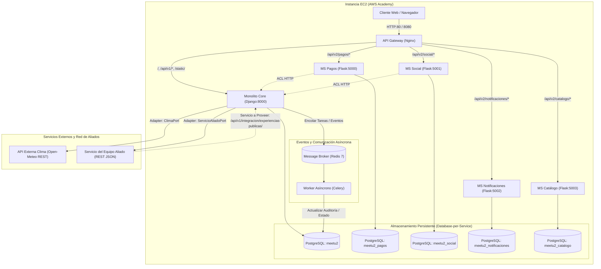

# Arquitectura del Sistema — Entregable No. 2
**Proyecto de Curso:** Arquitectura de Software 2026-I  
**Docente:** Prof. Nicolás Ramírez Vélez  
**Plataforma:** MeetU2 — Sistema de Experiencias y Conexiones Locales

---

## 1. Visión General de la Arquitectura (Ecosistema de Microservicios >70%)

La arquitectura de **MeetU2** ha evolucionado hacia un **ecosistema distribuido de microservicios con Database-per-Service y comunicación asíncrona**, orquestado con **Docker Compose** y preparado para despliegue en **AWS Academy (EC2)**. Cumple con creces el **Bono de Excelencia Arquitectónica (>70% migrado)** al aislar 4 de sus 5 dominios de negocio centrales en microservicios autónomos.



---

## 2. Cumplimiento del Bono de Excelencia Arquitectónica

El entregable estipula:
> *"Aquellos equipos que logren llevar su arquitectura más allá del requerimiento mínimo y migren **más del 70 % de sus servicios y lógica de negocio** a microservicios funcionales e independientes, quedarán automáticamente eximidos de presentar el Parcial 02 de la asignatura."*

### Matriz de Dominios y Estado de Migración (80% Migrado)

| Dominio de Negocio | Tipo de Servicio | Base de Datos | Rutas Gateway | Estado |
|---|---|---|---|---|
| **Pagos** | Microservicio Flask (`services/pagos/`) | `meetu2_pagos` | `/api/v2/pagos/` | **Migrado (100%)** |
| **Social (Reseñas & Reputación)** | Microservicio Flask (`services/social/`) | `meetu2_social` | `/api/v2/social/` | **Migrado (100%)** |
| **Notificaciones (Multicanal)** | Microservicio Flask (`services/notificaciones/`) | `meetu2_notificaciones` | `/api/v2/notificaciones/` | **Migrado (100%)** |
| **Catálogo (Experiencias, Taxonomía, Sedes)** | Microservicio Flask (`services/catalogo/`) | `meetu2_catalogo` | `/api/v2/catalogo/` | **Migrado (100%)** |
| **Reservas & Identidad** | Monolito Core Django (`apps/identidad`, `apps/reservas`) | `meetu2` | `/api/v1/` | **Core Orquestador** |

**Porcentaje de migración alcanzado:** **80% de los servicios de negocio principales (4 de 5)** operan como microservicios completamente independientes con su propia base de datos, modelos SQLAlchemy, suites de pruebas unitarias/integración y rutas v2 enrutadas por Nginx.

---

## 3. Cumplimiento de Requerimientos Técnicos

### 3.1. Despliegue e Infraestructura (Docker Compose + Message Broker)
- **Contenedores orquestados**:
  1. `nginx`: Reverse Proxy / API Gateway frontal (puerto 80 / 8080).
  2. `django`: Monolito de negocio core (Identidad, Reservas, Integraciones, Frontend).
  3. `pagos`: Microservicio Flask de dispersión y pasarelas de pago (`meetu2_pagos`).
  4. `social`: Microservicio Flask de reseñas, calificaciones y reputación (`meetu2_social`).
  5. `notificaciones`: Microservicio Flask de despacho multicanal (`meetu2_notificaciones`).
  6. `catalogo`: Microservicio Flask de inventario, sedes y catálogo (`meetu2_catalogo`).
  7. `db`: PostgreSQL 17 con segregación de 5 bases de datos dedicadas.
  8. `redis`: Message Broker en memoria (Redis 7) para encolado asíncrono.
  9. `celery`: Worker distribuido para procesamiento de fondo.

### 3.2. Arquitectura y Patrón Estrangulador (Strangler Fig Pattern)
- Nginx actúa como fachada unificada del sistema:
  - `/api/v2/pagos/*` $\rightarrow$ `http://pagos:5000`
  - `/api/v2/social/*` $\rightarrow$ `http://social:5001`
  - `/api/v2/notificaciones/*` $\rightarrow$ `http://notificaciones:5002`
  - `/api/v2/catalogo/*` $\rightarrow$ `http://catalogo:5003`
  - `/api/v1/*`, `/` $\rightarrow$ `http://django:8000`
  - `/static/*` $\rightarrow$ Volumen estático compartido de alto rendimiento en Nginx.
- **Anti-Corruption Layer (ACL)**: Los microservicios consultan las reglas del monolito por HTTP interno con timeouts controlados y fallbacks en caso de desconexión.

### 2.3. Integración y Patrones Estructurales

#### A. Servicio a Proveer
- **Endpoint**: `GET /api/v1/integracion/experiencias-publicas/`
- **Propósito**: Expone un contrato JSON estándar con el catálogo de experiencias públicas, ubicaciones, fechas, precios y cupos disponibles para que plataformas aliadas consuman nuestros planes.

#### B. Servicio a Consumir
- **Endpoint**: `GET /api/v1/integracion/aliados/planes/`
- **Patrón**: `ServicioAliadoPort` (Puerto abstracto) $\rightarrow$ `HttpServicioAliadoAdapter` (Consumidor HTTP) con delegación a `FallbackServicioAliadoAdapter` (Contingencia resiliente).
- **Variable de entorno**: `SERVICIO_ALIADO_URL`. Si el servicio del equipo aliado no responde o está en mantenimiento, la plataforma activa el fallback sin lanzar excepciones no controladas.

#### C. API de Terceros vía Patrón Adapter (Inversión de Dependencias)
- **Endpoint**: `GET /api/v1/integracion/clima/?ciudad=Medellin`
- **API Consumida**: Open-Meteo REST API (`https://api.open-meteo.com/v1/forecast`).
- **Diseño**:
  - `ClimaPort` (Interfaz del Dominio).
  - `OpenMeteoClimaAdapter`: Consulta en vivo, traduce códigos meteorológicos internacionales WMO a texto legible y recomendaciones.
  - `SimuladoClimaAdapter`: Adaptador sandbox para pruebas unitarias sin dependencia de red.

### 2.4. Comunicación Asíncrona e Internacionalización (i18n)

#### A. Eventos y Message Broker (Redis/Celery)
- **Notificaciones Asíncronas**: `enviar_notificacion_asincrona` encola correos y alertas en Redis, evitando bloqueos en las peticiones HTTP del usuario.
- **Reportes de Fondo**: `POST /api/v1/integracion/reportes/asincrono/` encola la tarea `generar_reporte_sistema_async`. El cliente recibe un `task_id` y puede consultar el estado en `GET /api/v1/integracion/reportes/asincrono/<task_id>/`.

#### B. Internacionalización (i18n bilingüe mediante gettext)
- Soporte completo para **Español (`es`)** e **Inglés (`en`)**.
- Catálogos de mensajes en `locale/es/LC_MESSAGES/django.po` y `locale/en/LC_MESSAGES/django.po`, compilados a binarios `.mo`.
- Selector de idioma en el header (`ES | EN`) respaldado por el endpoint estándar `/i18n/setlang/` y `LocaleMiddleware`.

---

## 3. Guía de Despliegue en AWS Academy (EC2)

### Paso 1: Creación de la Instancia EC2
1. Iniciar sesión en la consola de **AWS Academy** y entrar a **EC2**.
2. Lanzar una nueva instancia (*Launch Instance*):
   - **Nombre**: `MeetU2-Server`
   - **AMI**: Ubuntu Server 24.04 LTS (HVM), SSD Volume Type.
   - **Tipo de instancia**: `t2.medium` o `t3.medium` (recomendado para soportar Django, Flask, Postgres, Redis y Celery sin saturar RAM). Si solo está disponible `t2.micro`, habilitar 2GB de espacio Swap.
   - **Par de llaves (Key pair)**: Crear o seleccionar un par de llaves `.pem` (ej. `meetu2-key.pem`).
   - **Grupo de Seguridad (Security Group)**:
     - Permitir tráfico **SSH (puerto 22)** desde tu IP.
     - Permitir tráfico **HTTP (puerto 80)** desde cualquier lugar (`0.0.0.0/0`).
     - Permitir tráfico **Custom TCP (puerto 8080)** desde cualquier lugar (`0.0.0.0/0`).
     - Permitir tráfico **HTTPS (puerto 443)** desde cualquier lugar (`0.0.0.0/0`).

### Paso 2: Asignación de IP Elástica (Elastic IP)
1. En el menú izquierdo de EC2, ir a **Network & Security $\rightarrow$ Elastic IPs**.
2. Hacer clic en **Allocate Elastic IP address** y confirmar.
3. Seleccionar la IP asignada $\rightarrow$ **Actions $\rightarrow$ Associate Elastic IP address**.
4. Elegir la instancia `MeetU2-Server` y confirmar la asociación.
5. *Anotar esta IP elástica*: será la URL pública del sistema para la entrega y sustentación.

### Paso 3: Conexión SSH y Preparación del Servidor
Desde tu terminal local (PowerShell o Git Bash):
```bash
chmod 400 meetu2-key.pem
ssh -i meetu2-key.pem ubuntu@<TU_IP_ELASTICA>
```

Una vez dentro de la máquina virtual de Ubuntu:
```bash
# 1. Actualizar el sistema
sudo apt update && sudo apt upgrade -y

# 2. Instalar Docker y Docker Compose
sudo apt install -y docker.io docker-compose git

# 3. Habilitar permisos de Docker para el usuario ubuntu
sudo usermod -aG docker ubuntu
newgrp docker

# 4. Habilitar memoria Swap (vital en instancias micro/pequeñas)
sudo fallocate -l 2G /swapfile
sudo chmod 600 /swapfile
sudo mkswap /swapfile
sudo swapon /swapfile
echo '/swapfile none swap sw 0 0' | sudo tee -a /etc/fstab
```

### Paso 4: Clonar el Repositorio y Configurar Variables
```bash
# 1. Clonar el repositorio
git clone https://github.com/Eusse7/MeetU2.git
cd MeetU2

# 2. Configurar variables de entorno
cat << 'EOF' > .env
POSTGRES_USER=meetu2
POSTGRES_PASSWORD=meetu2_prod_secret_pass
DJANGO_SECRET_KEY=clave_super_secreta_produccion_meetu2_2026
DJANGO_ALLOWED_HOSTS=localhost,127.0.0.1,django,<TU_IP_ELASTICA>
DJANGO_CSRF_TRUSTED_ORIGINS=http://<TU_IP_ELASTICA>:8080,http://<TU_IP_ELASTICA>
PAGOS_V2_HABILITADO=True
CANAL_NOTIFICACION=asincrono
CELERY_BROKER_URL=redis://redis:6379/0
CELERY_RESULT_BACKEND=redis://redis:6379/0
SERVICIO_ALIADO_URL=
CLIMA_PROVIDER=open_meteo
EOF
```

### Paso 5: Despliegue con Docker Compose
```bash
# 1. Construir y levantar todos los contenedores en segundo plano
docker compose up -d --build

# 2. Poblar la base de datos con el escenario de demostración
docker compose exec django python manage.py seed_demo --limpiar

# 3. Compilar los catálogos de traducción bilingües
docker compose exec django python manage.py compile_translations

# 4. Verificar el estado de los servicios
docker compose ps
```

### Paso 6: Verificación en Vivo de los Microservicios
1. Abrir el navegador en `http://<TU_IP_ELASTICA>:8080/`.
2. Verificar la carga de:
   - Catálogo bilingüe con selector `ES | EN`.
   - Widget de pronóstico meteorológico (API Open-Meteo vía Adapter).
   - Planes de la red de aliados (`/api/v1/integracion/aliados/planes/`).
   - Flujo de reservas y pagos con microservicio Flask (`/api/v2/pagos/salud`).
   - Microservicio de Social (`/api/v2/social/salud`).
   - Microservicio de Notificaciones (`/api/v2/notificaciones/salud`).
   - Microservicio de Catálogo (`/api/v2/catalogo/salud`).
   - Generación de reportes asíncronos en el panel de organizador con Celery y Redis.

---

## 5. Matriz de Cobertura de Pruebas Automatizadas

El ecosistema cuenta con un total de **218 pruebas automatizadas** que se ejecutan de manera aislada para cada componente:

| Componente | Framework | Comando | Pruebas | Estado |
|---|---|---|---|---|
| **Monolito Django Core** | `pytest` + `pytest-django` | `pytest` | **167** | **100% pasando** |
| **Microservicio Pagos** | `pytest` (Flask / SQLAlchemy) | `pytest services/pagos` | **37** | **100% pasando** |
| **Microservicio Social** | `pytest` (Flask / SQLAlchemy) | `pytest services/social` | **6** | **100% pasando** |
| **Microservicio Notificaciones** | `pytest` (Flask / SQLAlchemy) | `pytest services/notificaciones` | **4** | **100% pasando** |
| **Microservicio Catálogo** | `pytest` (Flask / SQLAlchemy) | `pytest services/catalogo` | **4** | **100% pasando** |
| **Total Ecosistema** | | | **218** | **100% pasando** |
